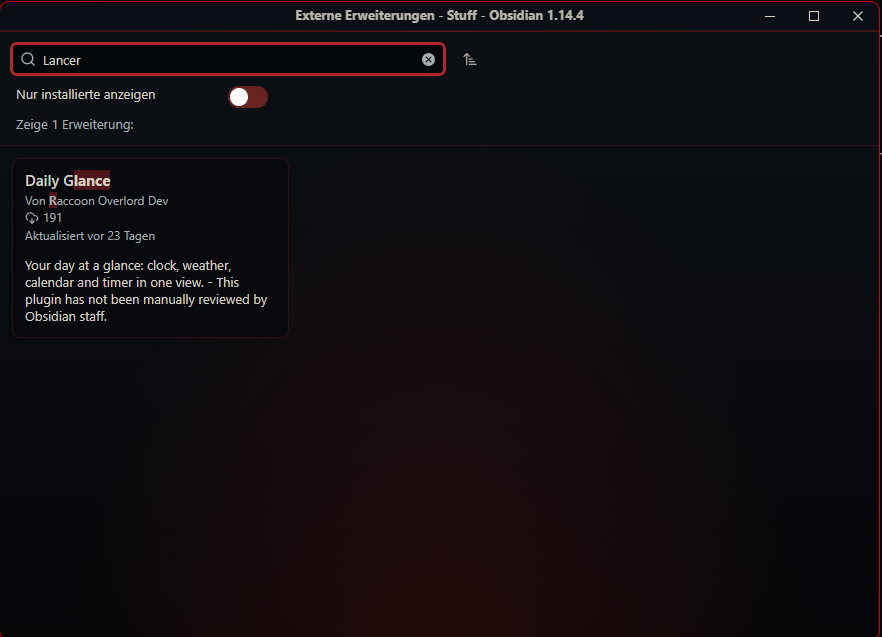

# Ginnungagap — Theme for Obsidian

> *Die gähnende Leere zwischen Niflheims Eis und Muspelheims Glut.*

**Ginnungagap** is an atmospheric, dark gothic fantasy theme for Obsidian inspired by Norse myth and ancient manuscript codices. Built around deep abyss black surfaces, bone-white and ash typography, and the vivid, glowing embers of Muspelheim (`#ff733d`, `#e14132`, `#b0282e`) paired with subtle Niflheim glacial frost (`#cfe0ea`, `#9cc4d8`).

---

## ⚔️ Key Features

- **Void & Abyss Backgrounds:** Pitch-black background tokens (`#07090c` / `#0b0f15`) designed to eliminate eye strain while creating maximum contrast.
- **Muspelheim Ember & Blood Accents:** Dynamic fiery glows on borders, active tabs, buttons, links, and selections.
- **Bone & Ash Typography:** Cold ash-gray headings paired with warm bone-white body text (`#d6d1c4`) for comfortable long reading sessions.
- **Atmospheric Gradients:** Subtle atmospheric radial lighting across the application container evoking the cosmic void between ice and fire.
- **Custom Font Stacks:** Built-in font hierarchy supporting *Cinzel*, *MedievalSharp*, *Georgia*, *Crimson Text*, and Runic character sets (*Segoe UI Historic*, *Noto Sans Runic*).
- **Styled UI Elements:**
  - Fire-ember pill tags
  - Custom scrollbars with subtle blood-red thumbs
  - Distinct active and focused tab indicators
  - Atmospheric blockquotes and callouts

---

## 📦 Installation

### From Obsidian Community Themes (Recommended)
1. Open Obsidian **Settings** (`Ctrl + ,`).
2. Navigate to **Appearance** ➔ **Themes** ➔ **Manage**.
3. Search for **Ginnungagap** and click **Install and use**.

### Manual Installation
1. Download `theme.css` and `manifest.json` from the [latest release](https://github.com/ShakToth/Ginnungagap-Obsidian-Theme/releases).
2. Inside your Obsidian vault, navigate to `.obsidian/themes/`.
3. Create a folder named `Ginnungagap` and place both files inside.
4. Go to **Settings** ➔ **Appearance** ➔ **Themes** and select **Ginnungagap**.

---

## 📜 License

Distributed under the [MIT License](LICENSE).
